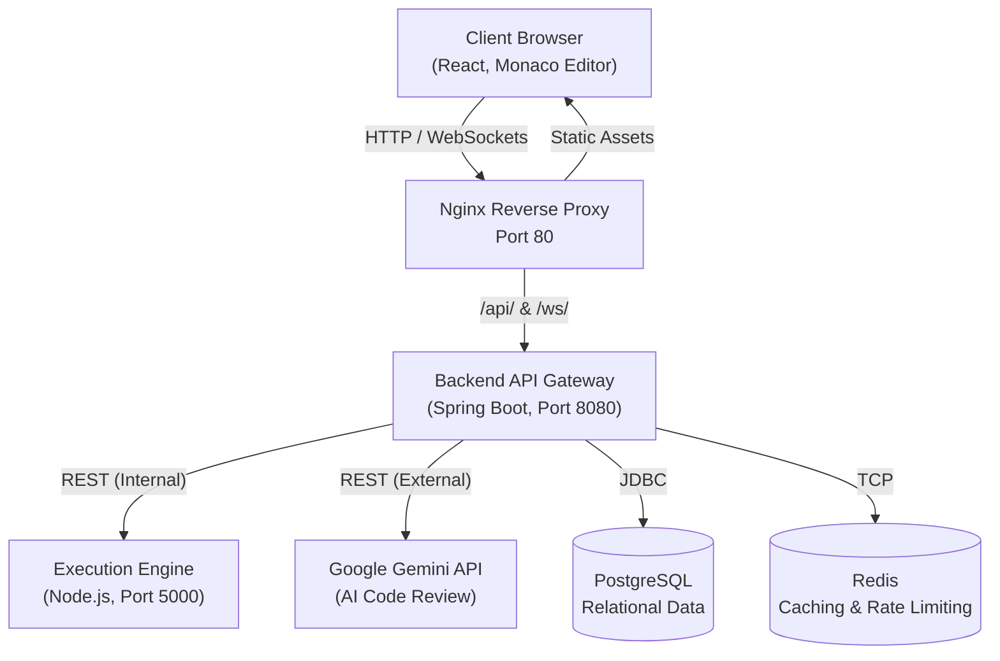

# 🏗️ High-Level Design (HLD): Codenix OJ

This document outlines the High-Level Design for **Codenix OJ**, a full-stack, distributed online judge and code execution platform.

---

## 1. System Architecture Overview

Codenix OJ follows a microservices-based architecture to isolate distinct responsibilities, especially separating the vulnerable code-execution environment from the core business logic.

---

## 2. Component Details

### 2.1. Frontend (Client Layer)
- **Tech Stack:** React (Vite), TypeScript, Tailwind CSS, Shadcn UI, Zustand.
- **Role:** Provides the interactive user interface. Features the Monaco Editor for writing code in various languages. It communicates with the backend via REST for standard operations (auth, submitting code) and via WebSockets (STOMP over SockJS) for receiving real-time compilation and execution status streams.

### 2.2. Reverse Proxy (Nginx)
- **Tech Stack:** Nginx (Alpine Docker Image).
- **Role:** Acts as the single entry point for the application. It serves the compiled static React assets and reverse-proxies all `/api/*` and `/ws/*` traffic to the internal Spring Boot Backend container, entirely bypassing CORS issues and abstracting internal container ports.

### 2.3. Core Backend API (API Gateway & Business Logic)
- **Tech Stack:** Java 21, Spring Boot 3, Spring Security, Spring Data JPA.
- **Role:** The central brain of the platform.
  - **Authentication:** Manages JWT-based user authentication and stateless sessions.
  - **Problem Management:** Serves coding problems and fetches associated hidden test cases from the database.
  - **Submission Orchestration:** When a user submits code, this service records the submission, forwards the code payload to the Execution Engine, and streams the live results back to the user via WebSockets.
  - **AI Integration:** Acts as a secure proxy to Google's Gemini API, constructing context-aware prompts for the "Explain Code" feature.

### 2.4. Execution Engine (Sandboxed Code Runner)
- **Tech Stack:** Node.js, Child Process, multi-language compiler toolchains (g++, javac, python3, go, rustc).
- **Role:** A dedicated microservice strictly responsible for executing untrusted user code. It accepts source code and input via REST, writes it to temporary isolated directories, compiles it (if required), and executes the binary while capturing `stdout`, `stderr`, and `exit codes`. 

### 2.5. Persistence & State Layer
- **PostgreSQL:** The primary source of truth. Stores structured, relational data including `Users`, `Problems`, `TestCases`, and `Submissions`.
- **Redis:** An in-memory data store used for high-speed caching and distributed rate-limiting (e.g., preventing users from spamming the execution engine with rapid requests).

---

## 3. Data Flow: Code Submission

1. **Submit:** The user writes C++ code and clicks "Submit". The React frontend sends a `POST /api/submissions` request to Nginx, which proxies it to the Spring Boot Backend.
2. **Validate & Record:** The Backend validates the JWT, looks up the requested problem and its test cases in PostgreSQL, and creates a "PENDING" submission record.
3. **Execute:** The Backend sends the source code and the test case inputs to the Node.js Execution Engine via internal REST.
4. **Compile & Run:** The Execution Engine saves the code to disk, compiles it (e.g., using `g++`), runs the resulting binary against the input, and captures the standard output.
5. **Evaluate:** The Backend compares the execution output against the expected output in the database.
6. **Stream Results:** Throughout this process, the Backend pushes status updates ("Compiling", "Running Test 1", "Accepted") back to the React frontend in real-time via the STOMP WebSocket connection.

---

## 4. Security Considerations

- **Network Isolation:** Microservices run on a private Docker bridge network. Only the Nginx port (80) is exposed to the public internet, protecting the Execution Engine and Databases from direct access.
- **Stateless Auth:** JSON Web Tokens (JWT) are used for authentication, ensuring backend instances can scale horizontally without sticky sessions.
- **AI Proxying:** The Gemini API key is securely held within the Spring Boot backend environment variables. The frontend never possesses the key, preventing quota abuse.
- **Rate Limiting:** A Redis-backed `RateLimitInterceptor` throttles requests to the `/api/compile` endpoint, mitigating Denial of Service (DoS) attempts against the expensive execution engine.
