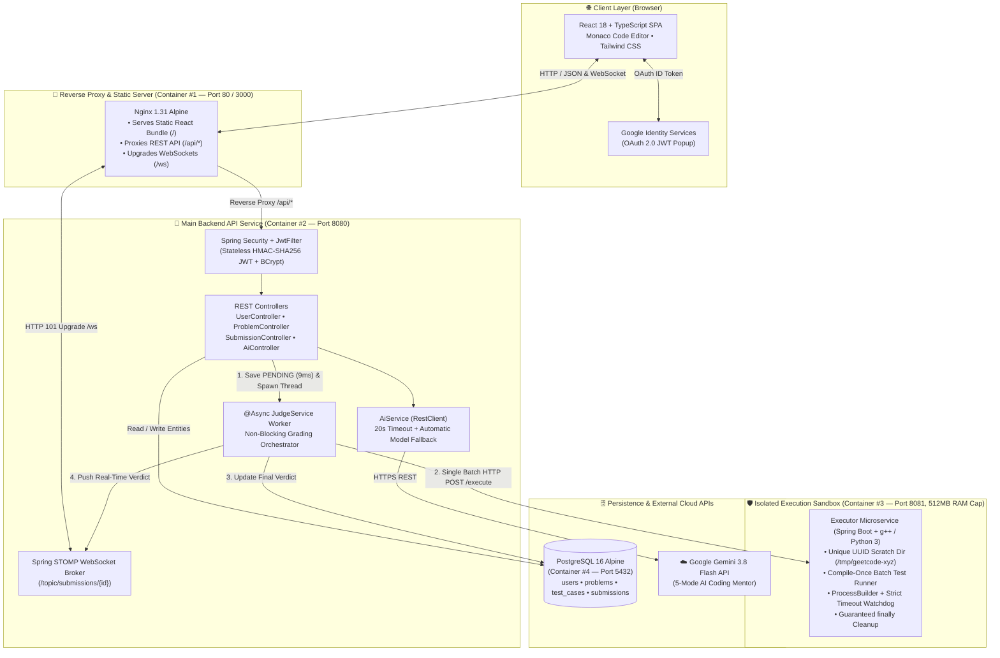
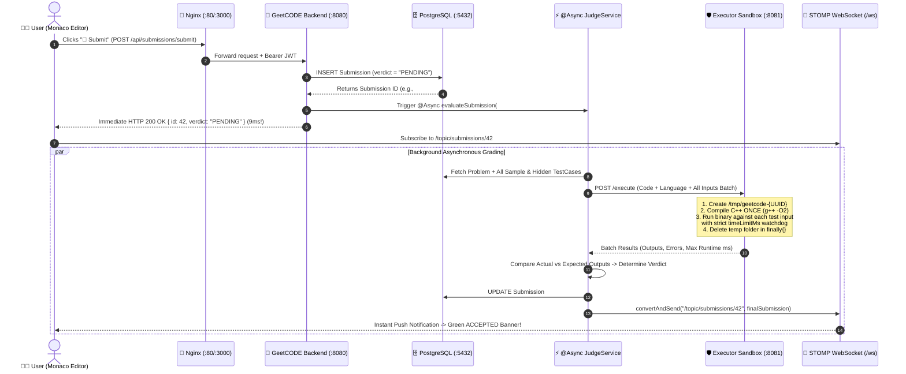

# ⚡ Codenix OJ — Distributed Online Judge & AI Coding Mentor

**Codenix OJ** is a full-stack, cloud-native **Distributed Online Judge Platform** (inspired by LeetCode & Codeforces) built with **Spring Boot 4 (Java 21)**, **React 18 + TypeScript (Monaco Editor)**, **PostgreSQL 16**, **STOMP WebSockets**, **Google OAuth 2.0**, **Gemini 3.8 Flash AI**, and **Docker Compose**.

It decouples untrusted code compilation and execution into a memory-capped **Isolated Executor Microservice Sandbox**, grades submissions asynchronously without blocking HTTP threads, and pushes live verdicts to the browser over **STOMP WebSockets** with sub-50ms p95 latency.

---

## 🏗️ High-Level Design (HLD) Architecture



---

## 🔄 End-to-End Workflow (How a Submission Works)



### Step-by-Step Lifecycle Breakdown

1. **Authentication & Security Gate (`JwtFilter` + Google OAuth 2.0)**
   - Users can sign in via **Google OAuth 2.0 Popup** (verified client-side via Google Identity Services and exchanged at `POST /api/auth/google`), standard email/password (`BCryptPasswordEncoder`), or 1-click Demo/Admin accounts.
   - The backend issues a stateless **HMAC-SHA256 JWT** (`24h` expiration). Every request passes through `JwtFilter`, which validates the signature before reaching protected endpoints.

2. **Two Execution Modes: `▶️ Run` vs. `🚀 Submit`**
   - **`▶️ Run` (`POST /api/submissions/run`)**: Stateless scratchpad mode. Executes user code against custom `stdin` in the sandbox and returns `stdout`/`stderr` + execution time directly without writing to PostgreSQL.
   - **`🚀 Submit` (`POST /api/submissions/submit`)**: Persistent asynchronous grading pipeline:
     1. Saves a `PENDING` submission row in PostgreSQL and returns a **receipt in `9 ms`** so HTTP threads never block during code execution.
     2. Spawns a background thread via Spring `@Async` (`JudgeService.evaluateSubmission`).
     3. Sends all test cases for the problem in a **single batch request** to the **Executor Sandbox (`:8081`)**.

3. **Compile-Once Sandboxed Execution (`executor-service`)**
   - Running inside a separate Docker container capped at **512 MB RAM** (`mem_limit: 512m`) so malicious memory bombs or infinite loops cannot crash the main API or database.
   - Creates an isolated `/tmp/geetcode-{UUID}` directory per request.
   - **Compile-Once Optimization**: Compiles C++ (`g++ -O2`) **once per submission** and reuses the compiled binary across all $N$ test cases using `ProcessBuilder` and `process.waitFor(timeLimitMs, TimeUnit.MILLISECONDS)`.
   - Automatically kills runaway processes (`process.destroyForcibly()`) to enforce **Time Limit Exceeded (`TLE`)** and deletes all temporary files inside a `finally` block.

4. **Real-Time Verdict Delivery via STOMP WebSockets**
   - As soon as the `@Async` worker updates PostgreSQL with the final verdict (`ACCEPTED`, `WRONG_ANSWER`, `TIME_LIMIT_EXCEEDED`, `COMPILATION_ERROR`, or `RUNTIME_ERROR`), `SimpMessagingTemplate` pushes the payload to `/topic/submissions/{id}`.
   - The React frontend receives the live event and updates the verdict banner, runtime metrics, and solved problem counters without polling.

5. **5-Mode Google Gemini 3.8 Flash AI Coding Mentor (`POST /api/ai`)**
   - Integrated directly into the coding workspace with 5 specialized modes: **✨ Hint**, **✨ Explain**, **✨ Debug**, **✨ Complexity (Big-O)**, and **✨ Review**.
   - Built with resilience: configures a `20s` read timeout on Spring's `RestClient` and automatically falls back from `gemini-3.8-flash` to `gemini-3.8-flash-lite` if the primary model experiences `503 High Demand`.

---

## 📊 Engineering Benchmarks & Performance Metrics

| Metric | Measured Result | Architectural Driver |
| :--- | :--- | :--- |
| **C++ 20-Test-Case Grading Speedup** | **`11,324 ms` $\rightarrow$ `1,018 ms` (`11.1×` faster)** | Compile-once batch execution (`g++ -O2` once per submission vs. per test case) |
| **Submission Receipt Latency** | **`9 ms`** | Decoupled `@Async` grading + instant `PENDING` receipt + STOMP WebSocket push |
| **100 Concurrent Submissions (`p95`)** | **`47 ms` (`0%` failure rate)** | Non-blocking HTTP controller threads + isolated execution container |
| **Unit Test Coverage (JaCoCo)** | **`100%` (`JwtUtil`) / `90%` (`CodeRunnerService`)** | 18 JUnit 5 + Mockito tests covering security, grading verdicts, TLE, & cleanup |

---

## 🗂️ Repository Structure

```text
Codenix-OJ/
├── docker-compose.yml          # Orchestrates Postgres, Executor, Backend, and Frontend
├── .env.example                # Template for GEMINI_API_KEY
├── GeetCODE/                   # Main Spring Boot Backend API (Port 8080)
│   ├── Dockerfile              # Multi-stage Maven build -> Eclipse Temurin JRE 21
│   ├── pom.xml
│   └── src/
│       ├── main/java/com/geetcode/
│       │   ├── controller/     # UserController, ProblemController, SubmissionController, AiController
│       │   ├── entity/         # User, Problem, TestCase, Submission (JPA Entities)
│       │   ├── repository/     # Spring Data JPA Repositories
│       │   ├── security/       # JwtUtil, JwtFilter, SecurityConfig, WebSocketConfig
│       │   └── service/        # UserService, ProblemService, JudgeService, AiService, DataSeeder (30 DSA Problems)
│       └── test/java/          # JUnit 5 + Mockito Test Suites (JwtUtilTest, UserServiceTest, ProblemServiceTest, JudgeServiceTest)
├── executor-service/           # Isolated Code Execution Microservice (Port 8081)
│   ├── Dockerfile              # Alpine Linux + Java 21 + g++ (build-base) + Python 3
│   ├── pom.xml
│   └── src/
│       ├── main/java/com/geetcode/executor/
│       │   ├── ExecuteController.java
│       │   └── CodeRunnerService.java
│       └── test/java/          # CodeRunnerServiceTest (C++, Python, Compile Error, TLE Watchdog)
└── frontend/                   # React 18 + TypeScript + Vite + Monaco Editor (Port 80 / 3000)
    ├── Dockerfile              # Multi-stage Node 20 build -> Nginx 1.31 Alpine
    ├── nginx.conf              # Reverse proxy for /api/* and WebSocket /ws upgrade
    └── src/
        ├── App.tsx             # Dashboard, Topic Filters, Split-Pane IDE, AI Mentor, Google OAuth
        └── api.ts              # Axios/Fetch REST client + @stomp/stompjs WebSocket client
```

---

## 🚀 Quick Start (Run Everything in 1 Command)

### Prerequisites
- [Docker Desktop](https://www.docker.com/products/docker-desktop/) (or Docker Engine + Docker Compose on Linux/AWS EC2)

### 1. Clone the Repository
```bash
git clone https://github.com/Prachi01Yadav/Codenix-OJ.git
cd Codenix-OJ
```

### 2. Configure Your `.env` File
Create a `.env` file in the root directory:
```env
GEMINI_API_KEY=your_google_gemini_api_key_here
```

### 3. Build & Launch All 4 Containers
```bash
docker compose up --build -d
```

### 4. Open Codenix OJ
- **Frontend Web IDE:** [http://localhost:3000](http://localhost:3000) *(or `http://localhost` on port 80)*
- **Main Backend API:** `http://localhost:8080`
- **Isolated Executor Service:** `http://localhost:8081`

> **Default Seeded Accounts (30 Classic DSA Problems pre-loaded automatically):**
> - **Demo User:** `demo@geetcode.com` / `demo123`
> - **Admin User:** `admin@geetcode.com` / `admin123` *(can create & delete problems)*
> - Or click **Continue with Google** to sign in with any Google account!

---

## ☁️ Deploying on AWS EC2 (Ubuntu 24.04 LTS)

```bash
# 1. Install Docker & Docker Compose on Ubuntu EC2
sudo apt-get update
sudo apt-get install -y docker.io docker-compose-v2 git
sudo usermod -aG docker ubuntu
newgrp docker

# 2. (Recommended on 1GB RAM Free-Tier t2.micro/t3.micro) Add 2GB Swap File
sudo fallocate -l 2G /swapfile
sudo chmod 600 /swapfile
sudo mkswap /swapfile
sudo swapon /swapfile

# 3. Clone & Start Codenix OJ
git clone https://github.com/Prachi01Yadav/Codenix-OJ.git
cd Codenix-OJ
echo "GEMINI_API_KEY=your_api_key_here" > .env
docker compose up --build -d
```

